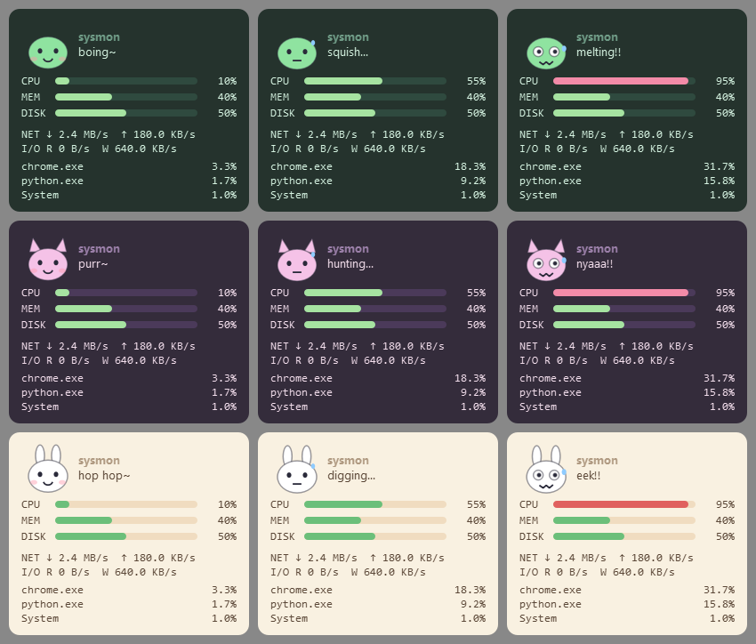

# sysmon

**English** | [简体中文](README.zh-CN.md)

A tiny system monitor written in Python, for the terminal and the desktop. Built on [psutil](https://github.com/giampaolo/psutil) and [rich](https://github.com/Textualize/rich), with an optional floating window ([PySide6](https://doc.qt.io/qtforpython-6/)) that has skins and a cartoon mascot.

It shows CPU, memory and disk usage, network and disk I/O speed, and the top processes, refreshing live.



## Features

- Live terminal view: CPU, memory, disk, network up/down and disk read/write speed, top processes
- Sort processes by CPU or memory, filter by name
- End a process by PID from the command line, or by right-clicking it in the floating window (always asks first)
- Export a snapshot as JSON, ready for scripts and pipes
- Floating always-on-top window: drag to move, double-click to collapse, remembers its position and settings
- Skins and a cartoon mascot whose face follows your system load; make your own skins with a small JSON file

Requires Python 3.9 or newer (declared in `pyproject.toml`). Developed and tested on Windows 11 with Python 3.15; the command-line view should also work on Linux and macOS but has not been tested there.

## Install

```bash
git clone https://github.com/ethannn0o0/sysmon.git
cd sysmon
pip install -e .          # command-line monitor
pip install -e ".[gui]"   # plus the floating window (installs PySide6)
```

## Usage

```bash
sysmon                    # live view, Ctrl+C to quit
sysmon --once             # print a single snapshot
sysmon -n 20 -s memory    # top 20 processes by memory
sysmon -f chrome          # only processes whose name contains 'chrome'
sysmon -i 2               # refresh every 2 seconds
sysmon --gui              # floating window (drag to move, right-click for the menu)
sysmon kill 1234          # end PID 1234 (asks for confirmation)
sysmon kill 1234 -f -y    # force-kill, no confirmation
sysmon --json             # print one snapshot as JSON (pipe-friendly)
sysmon --json -o out.json # write the snapshot to a file
python -m sysmon          # run without installing the script
```

In the floating window: **left-drag** moves it, **double-click** collapses it to the three bars, **right-click** opens the menu (skin, sort order, compact mode, always on top, opacity, quit). Right-clicking a process row adds **End process…**.

## Skins

Right-click the floating window → **Skin**. Built-in skins: Midnight, Slime, Kitty, Sunny Bunny. The cartoon mascot changes expression with system load (idle / busy / overload).

Make your own: choose **Skin → Open skins folder…** (this creates `~/.sysmon/skins/` with an example), copy the example folder and edit its `skin.json`. New skins appear in the menu immediately.

```json
{
  "name": "My Skin",
  "colors": {"bg": "#1e1e2e", "track": "#45475a", "text": "#cdd6f4", "dim": "#6c7086",
             "good": "#a6e3a1", "warn": "#f9e2af", "bad": "#f38ba8"},
  "bg_alpha": 0.9,
  "radius": 12,
  "mascot": {
    "builtin": "cat",
    "color": "#f5c2e7",
    "frames": {"idle": "idle.png", "busy": "busy.png", "overload": "overload.png"}
  },
  "lines": {"idle": "purr~", "busy": "hunting...", "overload": "nyaaa!!"}
}
```

- Every field is optional. Invalid values fall back to defaults, and a broken skin is skipped.
- `mascot.builtin` is `blob`, `cat` or `bunny` (drawn in code). `frames` are your own images (png/jpg/webp, inside the skin folder) and take priority. `idle` is required; missing moods reuse it.
- Mood: overload at CPU ≥ 80% or memory ≥ 92%; busy at CPU ≥ 40% or memory ≥ 80%.
- Skins contain no code, only colours and images. Image paths cannot point outside the skin folder.

## Development

```bash
pip install -e ".[dev,gui]"
pytest
```

The GUI tests run without a display (Qt's offscreen mode) and are skipped if PySide6 is not installed.

## Roadmap

- [x] End a process by PID
- [x] Process name filter
- [x] Export a snapshot as JSON
- [x] Network and disk I/O speed
- [x] Skins and a cartoon mascot
- [ ] Interactive terminal UI with [Textual](https://github.com/Textualize/textual)
- [ ] Per-core CPU view
- [ ] Windows installer (.exe)

## License

[MIT](LICENSE) © 2026 ethannn0o0

Dependencies keep their own licenses: [psutil](https://github.com/giampaolo/psutil) (BSD-3-Clause), [rich](https://github.com/Textualize/rich) (MIT), and the optional floating window uses [PySide6](https://doc.qt.io/qtforpython-6/) (LGPL-3.0). sysmon does not bundle any of them; pip installs them separately.
