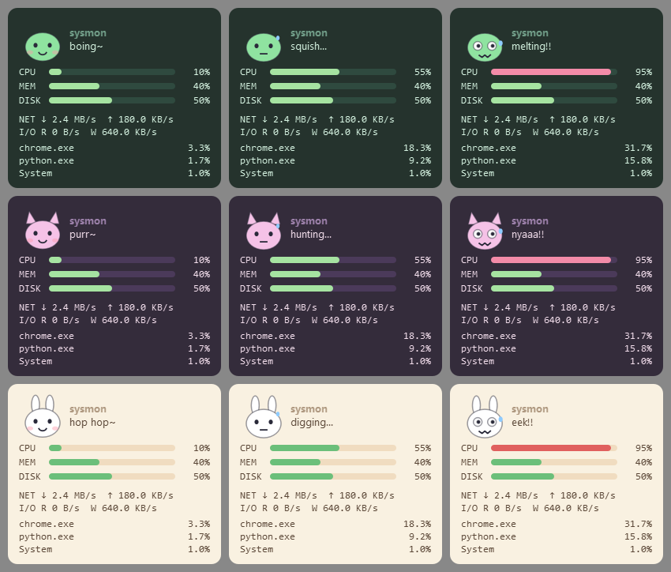

# sysmon

[English](README.md) | **简体中文**

一个用 Python 写的轻量系统监控工具，既能在终端里用，也能做成桌面悬浮窗。基于 [psutil](https://github.com/giampaolo/psutil) 和 [rich](https://github.com/Textualize/rich)，另有可选的悬浮窗界面（[PySide6](https://doc.qt.io/qtforpython-6/)），支持换皮肤和卡通吉祥物。

实时显示 CPU、内存、磁盘占用，网络和磁盘读写速度，以及占用最高的进程。



## 功能

- 终端实时视图：CPU、内存、磁盘、网络上传/下载速度、磁盘读写速度、进程排行
- 进程可按 CPU 或内存排序，也可按名字过滤
- 可在命令行里按 PID 结束进程，也可在悬浮窗里右键进程结束（结束前一定会先确认）
- 把一次快照导出为 JSON，方便脚本和管道使用
- 悬浮窗：始终置顶，拖动移动，双击收起，自动记住位置和设置
- 皮肤和卡通吉祥物：吉祥物的表情会随系统负载变化，用一个小 JSON 文件就能做自己的皮肤

需要 Python 3.9 或更高版本（写在 `pyproject.toml` 里）。开发和测试环境是 Windows 11 加 Python 3.15；命令行视图理论上也能在 Linux 和 macOS 上运行，但还没有在那些系统上测试过。

## 安装

```bash
git clone https://github.com/ethannn0o0/sysmon.git
cd sysmon
pip install -e .          # 命令行监控
pip install -e ".[gui]"   # 加上悬浮窗（会安装 PySide6）
```

## 使用

```bash
sysmon                    # 实时视图，Ctrl+C 退出
sysmon --once             # 只打印一次
sysmon -n 20 -s memory    # 按内存排序，显示前 20 个进程
sysmon -f chrome          # 只显示名字包含 chrome 的进程
sysmon -i 2               # 每 2 秒刷新一次
sysmon --gui              # 悬浮窗（拖动移动，右键打开菜单）
sysmon kill 1234          # 结束 PID 为 1234 的进程（会先确认）
sysmon kill 1234 -f -y    # 强制结束，不确认
sysmon --json             # 以 JSON 输出一次快照（适合管道）
sysmon --json -o out.json # 把快照写入文件
python -m sysmon          # 不安装命令也能运行
```

悬浮窗操作：**左键拖动**移动位置，**双击**收起成只剩三条进度条，**右键**打开菜单（换皮肤、排序方式、紧凑模式、置顶、透明度、退出）。在某个进程行上右键，菜单里会多出 **End process…**（结束进程）。

## 皮肤

右键悬浮窗 → **Skin**。内置皮肤：Midnight、Slime、Kitty、Sunny Bunny。卡通吉祥物会随系统负载变换表情（空闲 / 忙碌 / 过载）。

自己做皮肤：选择 **Skin → Open skins folder…**（会创建 `~/.sysmon/skins/` 并放入一个示例），复制示例文件夹，修改里面的 `skin.json`。新皮肤会立刻出现在菜单里。

```json
{
  "name": "My Skin",
  "colors": {"bg": "#1e1e2e", "track": "#45475a", "text": "#cdd6f4", "dim": "#6c7086",
             "good": "#a6e3a1", "warn": "#f9e2af", "bad": "#f38ba8"},
  "bg_alpha": 0.9,
  "radius": 12,
  "mascot": {
    "builtin": "cat",
    "color": "#f5c2e7",
    "frames": {"idle": "idle.png", "busy": "busy.png", "overload": "overload.png"}
  },
  "lines": {"idle": "purr~", "busy": "hunting...", "overload": "nyaaa!!"}
}
```

- 所有字段都是可选的。值无效时会回退到默认值，损坏的皮肤会被跳过。
- `mascot.builtin` 可选 `blob`、`cat`、`bunny`（用代码绘制）。`frames` 是你自己的图片（png/jpg/webp，放在皮肤文件夹内），优先于内置形象。`idle` 必填，缺少的表情会复用它。
- 表情规则：CPU ≥ 80% 或内存 ≥ 92% 为过载；CPU ≥ 40% 或内存 ≥ 80% 为忙碌。
- 皮肤里没有代码，只有颜色和图片，图片路径也不能指向皮肤文件夹之外。

## 开发

```bash
pip install -e ".[dev,gui]"
pytest
```

界面测试使用 Qt 的离屏模式，不需要显示器；没有安装 PySide6 时会自动跳过。

## 路线图

- [x] 按 PID 结束进程
- [x] 按名字过滤进程
- [x] 把快照导出为 JSON
- [x] 网络和磁盘读写速度
- [x] 皮肤和卡通吉祥物
- [ ] 用 [Textual](https://github.com/Textualize/textual) 做交互式终端界面
- [ ] 按核心显示 CPU 占用
- [ ] Windows 安装包（.exe）

## 许可证

[MIT](LICENSE) © 2026 ethannn0o0

依赖库各自保留自己的许可证：[psutil](https://github.com/giampaolo/psutil)（BSD-3-Clause）、[rich](https://github.com/Textualize/rich)（MIT）；可选的悬浮窗使用 [PySide6](https://doc.qt.io/qtforpython-6/)（LGPL-3.0）。sysmon 不打包这些库，它们由 pip 另行安装。
